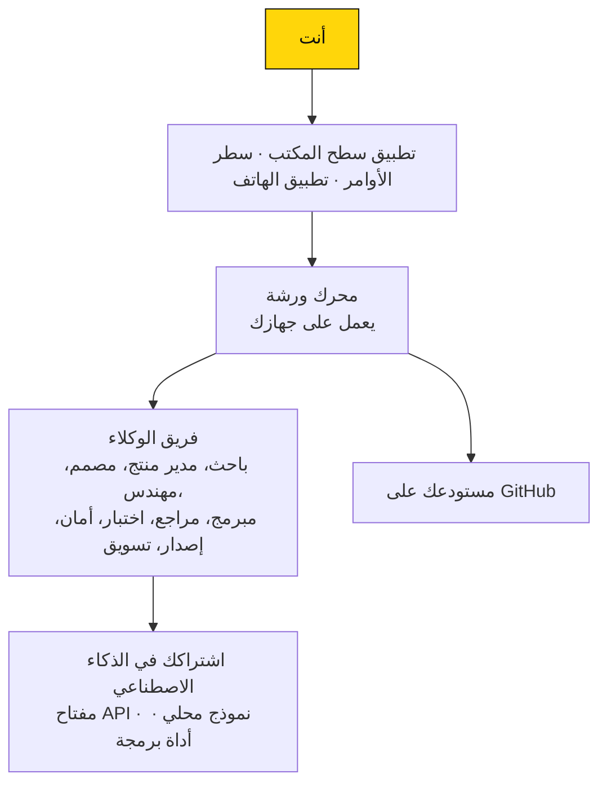

<a href="README.md">English</a> · <b>العربية</b>

  

<b>حوّل فكرة تطبيقك إلى منتج حقيقي، مع فريق من وكلاء الذكاء الاصطناعي، والقرار دائمًا بيدك.</b>

  
  

> [!WARNING]
> **الحالة: مبنية ومتحقَّق منها محليًا، ولا يوجد إصدار منشور.** الخادم وتطبيق سطح المكتب وتطبيق الهاتف
> تُبنى وتعمل من المصدر، والفحوصات الآلية ناجحة: ٧٢٥ اختبار Rust، و١٠٠١ اختبار TypeScript، و٧٨٥ حالة
> Playwright من طرف إلى طرف. وفحص `warsha-desktop.exe --self-check` ينجح في ١١ من ١١ بندًا، ومنها دورة
> كاملة: مشروع ← تشغيل ← البوابة A ← المتابعة بمزود وهمي بلا مفاتيح. لكن **لا يوجد ما يُحمَّل بعد**:
> لا وسم ولا إصدار منشور. راجع [المتحقق منه اليوم](#المتحقق-منه-اليوم) و[خارطة الطريق](#خارطة-الطريق).

## ما هي ورشة؟

ورشة تطبيق يعمل كأنه فريق برمجة صغير. تكتب فكرتك بكلمات بسيطة، بالعربية أو بالإنجليزية، فيتولى فريق من وكلاء الذكاء الاصطناعي دراستها وكتابة مواصفاتها وتصميمها والتخطيط لها، ثم كتابة الكود واختباره ومراجعته وتجهيز الإصدار. وأنت توافق على كل خطوة مهمة.

- **العربية أولًا:** واجهة عربية كاملة من اليمين إلى اليسار، ومعها الإنجليزية.
- **أنت صاحب القرار:** لا شيء يُدمج أو يُنشر إلا بموافقتك.
- **استخدم اشتراكك الحالي:** تربط خدمة الذكاء الاصطناعي التي تملكها بالفعل، بدل أن تشترك في خدمة جديدة.
- **تابع من أي مكان:** راقب سير العمل ووافق على الخطوات من هاتفك.

## لمن صُممت ورشة؟

- لمن عنده فكرة تطبيق ولا يعرف البرمجة.
- لرواد الأعمال والفرق الصغيرة الذين يريدون الوصول إلى نسخة أولى أسرع.
- للمبرمجين الذين يريدون فريقًا ينجز العمل المتكرر بينما يتفرغون هم للمراجعة.

## الرحلة من الفكرة إلى الإصدار

الخطوات الصفراء هي **البوابات**: يتوقف عندها الوكلاء وينتظرون قرارك.

```mermaid
flowchart RL
  I([فكرتك]) --> GA{{البوابة A<br/>اعتماد الفكرة}}
  GA --> R[البحث] --> S[المواصفات]
  S --> GB{{البوابة B<br/>اعتماد المواصفات}}
  GB -- رفض --> S
  GB --> D[التصميم] --> P[الخطة] --> C[الكود]
  C --> T[الاختبار والمراجعة والأمان]
  T --> GC{{البوابة C<br/>اعتماد الدمج}}
  GC --> REL[الإصدار] --> L[مسودات الإطلاق]
  L --> GD{{البوابة D<br/>اعتماد النشر}}
  GD --> F[الملاحظات] -.-> I
  classDef gate fill:#FFD60A,stroke:#0E0E0E,color:#0E0E0E;
  class GA,GB,GC,GD gate;
```

## كيف تتكامل الأجزاء؟

## كيف ستبدو؟

<i>تصوّر مبدئي للتخطيط النهائي — وليس لقطة شاشة للتطبيق العامل.</i>

## طريقة الاستخدام

لا يوجد ما يُحمَّل من الموقع حتى الآن، فالخطوة الأولى أدناه تصف بناءً تصنعه بنفسك. البناء من المصدر
موثّق في [docs/DEVELOPERS.md](docs/DEVELOPERS.md)، وأمر بناء الإصدار نفسه ينتج حزمة تثبيت.

1. **التثبيت من بناءك الخاص:** ابنِ حزمة الإصدار على نظامك وشغّل برنامج التثبيت.
   *(تم التحقق على ويندوز، وحزم macOS وLinux تنتج من الأمر نفسه لكنها لم تُبنَ في هذه الجولة. ولا يوجد
   رابط تحميل منشور — راجع <a href="#خارطة-الطريق">خارطة الطريق</a>.)*
2. **اختيار اللغة:** تختار العربية أو الإنجليزية عند أول تشغيل.
3. **ربط الذكاء الاصطناعي:** تضيف ما لديك بالفعل: مفتاح API — بروابط ونماذج افتراضية بنقرة واحدة لـ OpenRouter وDeepSeek وKimi وGLM وQwen، أو أي وجهة أخرى (OpenAI أو Anthropic) برابطها الخاص — أو نموذجًا يعمل على جهازك (Ollama أو LM Studio؛ محوّلهما المحلي يتجاهل حقل المفتاح، لكن النموذج يطلبه مع ذلك). أما أدوات البرمجة الرسمية التي تستخدمها (Claude Code أو Codex CLI أو Gemini CLI أو Cursor CLI) فيتعرّف عليها الخادم على `PATH` ولا يقودها المسار بعد. وتُحفظ المفاتيح في الخزنة الآمنة لنظام التشغيل — راجع <a href="#ما-الاشتراكات-التي-تعمل-معها">الأسئلة الشائعة</a> لما يعمل وما لا يعمل اليوم.
4. **ربط GitHub:** تمنح ورشة رمز وصول إلى GitHub حتى تجهّز مستودعًا لمشروعك. أدوات GitHub موجودة في
   الشيفرة (`crates/warsha-git`)، لكن لا شاشة ولا أمر يستعملها بعد، فلا تُنشأ مستودعات ولا تُفتح قضايا ولا
   تُطلب دمجاتها إلى اليوم.
5. **بدء مشروع:** تكتب فكرتك في جملة أو اثنتين، مثل: *«تطبيق مهام يعمل دون إنترنت».*
6. **متابعة الفريق:** تعرض اللوحة الجانبية كل وكيل وملخصًا قصيرًا وبسيطًا لما أنجزه، وتوضح لوحة المشروع المرحلة التي وصل إليها.
7. **الموافقة أو الرفض عند كل بوابة:** تقرأ ما أنتجه الوكلاء (ملخص الفكرة، المواصفات، تعديلات الكود، نصوص الإطلاق)، ثم توافق ليستمر العمل، أو ترفض مع ذكر السبب باختصار فيعيد الوكلاء العمل عليه.
8. **المتابعة من الهاتف:** تمسح رمز QR من تطبيق سطح المكتب لربط هاتفك، فترى الحالة لحظة بلحظة، وتحادث
   الوكيل الحالي، وتوافق على البوابات. ويسجّل التطبيق **خدمة خلفية للقشرة فقط** (Shell worker): بناء الإنتاج
   يُصدر `dist/sw.js` ويسجّلها `registerShellWorker`، فتُفتح الواجهة دون اتصال. تُخزّن القشرة وحدها ولا تحتفظ
   بأي رد من الخادم، ولا تطلب **إذن الإشعارات**، فلا إشعارات على هاتفك ولا يصل إليه شيء من تلقاء نفسه، بل
   تفتحه أنت عندما تريد المتابعة.
9. **استلام الإصدار:** الحالة النهائية التي بُني لها المسار: مستودع على GitHub فيه الكود، والفحوصات ناجحة، ومسودة إصدار، ومسودات لنصوص المتاجر. لكن أتمتة GitHub غير موصولة بعد (الخطوة ٤)، فهذه الخطوة الأخيرة تُنجز يدويًا اليوم؛ وورشة لا تنشر أي شيء من تلقاء نفسها.

تفضّل سطر الأوامر؟ أمر `warsha` متاح اليوم، مثل `warsha new "فكرتك"` و`warsha status` و
`warsha approve <معرف التشغيل> <البوابة>` و`warsha pair <بيانات QR>`. وهو يخاطب خادم `warshad` عبر
JSON-RPC، فشغّل الخادم أولًا؛ وإلا أجابك كل أمر بعبارة `Not connected to daemon`. قائمة الأوامر والأعلام
بما يعمل منها فعلًا موثّقة في <a href="docs/src/user-guide.ar.md">دليل المستخدم بالعربية</a>.

## المتحقق منه اليوم

قيس في ٢٠٢٦-١١-٠٥ إلى ٢٠٢٦-١١-٠٨ على جهاز ويندوز وعلى مضيف التقاط Linux x86_64 بخطوط مثبَّتة:

| البوابة | الأمر | النتيجة |
|---|---|---|
| اختبارات Rust | `cargo test --workspace --no-fail-fast` | ٧٢٥ ناجحًا، ٠ فاشل |
| اختبارات TypeScript | `pnpm -r test` | ١٠٠١ ناجح |
| التدقيق والأنواع والبناء | `pnpm -r lint` · `pnpm -r typecheck` · `pnpm -r build` | رمز خروج ٠ لكلٍّ منها |
| إمكانية الوصول | Playwright `screens.a11y` | ١٨٨ مُدرجة، ١٨٠ ناجحًا، ٨ فاشلة — كلها في شاشة `settings` (قاعدة axe ‏`aria-required-children`) |
| حالات الواجهة | Playwright `states` | ٢٥٢ ناجحًا |
| الانحدار البصري | Playwright `screens.visual` | ٣٠٨ ناجحًا |
| المسارات السلوكية | Playwright `flows` و`layout` و`onboarding` | ٤٥ ناجحًا |
| غلاف سطح المكتب | `warsha-desktop.exe --self-check` | ١١/١١ ناجحًا |

وما **لا** يغطيه هذا: اللقطات المرجعية البصرية التُقطت على Linux x86_64 فقط، فعرض ويندوز وماك غير
متحقَّق منه؛ وقناة التشفير من طرف إلى طرف عبر الوسيط غير منفَّذة؛ وتأليف الروتينات وتصدير حزمة الخادم
غير موصولين بشاشتيهما؛ ولا توجد حزمة APK لأندرويد مبنية في هذا المستودع.

## خارطة الطريق

الطريق إلى النسخة الأولى، دون مواعيد محددة. النسخ الموجودة في الشيفرة اليوم: تطبيق سطح المكتب
**0.2.0** (`apps/desktop/src-tauri/tauri.conf.json`) وحِزم Rust **0.1.0** (`Cargo.toml`)، ولا وسم
git ولا إصدار منشور لأيٍّ منهما.

| المرحلة | ما تقدمه | الحالة |
|---|---|---|
| M0 | أساس المشروع والفحوصات التلقائية | ✅ منجزة |
| M1 | المحرك الخلفي وحفظ الحالة | ✅ منجزة |
| M2 | ربط مزودي الذكاء الاصطناعي والميزانية وتتبع التكلفة | ✅ منجزة |
| M3 | مسار الوكلاء وبوابات الموافقة | ✅ منجزة |
| M4 | أداة سطر الأوامر `warsha` | ✅ منجزة |
| M5 | تطبيق سطح المكتب | ✅ منجز على ويندوز |
| M6 | تطبيق الهاتف مع ربط آمن | 🟡 الربط الآمن منجز؛ والقناة من طرف إلى طرف غير منفَّذة |
| M7 | وكلاء البرمجة والتكامل مع GitHub | 🟡 الواجهات الخلفية منجزة؛ وأدوات GitHub موجودة لكن لا شاشة ولا أمر يستعملها |
| M8 | العربية والإنجليزية بالكامل، والاتجاه من اليمين إلى اليسار | ✅ منجزة |
| M9 | برامج التثبيت والإصدارات والتوثيق | 🟡 حزمة تثبيت محلية مبنية؛ ولا إصدار منشور |
| M10 | وكيل المنسّق ومقابلة الاستكشاف | ✅ منجزة |
| M11 | نظام المهارات وحزم الأدوار | ✅ منجزة |
| M12 | دعم MCP ومستكشف المهارات وخوادم MCP | ✅ منجزة |
| M13 | تطبيق سطح المكتب بوضعي «البسيط» و«المتقدّم» ومفتاح واحد بينهما | ✅ منجزة |
| M14 | طبقة أمان الوكلاء وجودتهم: الحواجز وموجّه النماذج والتتبّع والتقييمات | ✅ منجزة |
| M15 | التسويق والتواصل الاجتماعي ومواد الإطلاق | ✅ منجزة |
| M16 | حلقة التطوير المستمر: التحديثات والروتينات والأتمتة | ✅ منجزة؛ وتبقى خطوات ينجزها المالك (مفاتيح المحدّث وتطبيق Renovate) |
| M17 | العناية بعد الإطلاق: تقارير الأعطال ومراجعات المتاجر والملخص اليومي | ✅ منجزة؛ بلا مُجمِّع ولا عميل متاجر ولا إشعارات دفع |
| M18 | سير عمل الوكيل: وضعا المخطط والتنفيذ والإشارات والضغط والتلخيص | ✅ منجزة؛ الإشارات تحمل أهدافها لا محتوى الملفات |
| M19 | حزمة الخادم: تعريف PocketBase/Supabase والتصدير | ✅ منجزة؛ لم تُقَد عبر MCP بعد |
| M20 | الأساسات: قواعد البنية ورموز التصميم ووحدات التخزين المؤقت وأنماط التشغيل | 🟡 منجزة على دفعات؛ دفعات الأساس والمتابعة ما زالت تصدر |
| Wave 2 | مصنع البرمجيات الكامل: الأُطُر والمهارات والإضافات والموصّلات والملفات وواجهة الوضعين | ✅ منجزة |

## أسئلة شائعة

**كم تكلّف؟**
ورشة نفسها لا تطلب منك شيئًا. أنت تستخدم مزود الذكاء الاصطناعي الخاص بك، فأي تكلفة هي ما تدفعه له أصلًا. وستعرض ورشة عدّادًا للتكلفة، وتتيح لك تحديد ميزانية تتوقف عندها قبل تجاوزها.

**أين تُحفظ بياناتي؟**
على جهازك. المشاريع والسجل والملفات تبقى محليًا في ملف SQLite واحد تملكه أنت، ولا يُكتب فيه أي مفتاح،
فالمفاتيح تُحفظ في خزنة نظام التشغيل فقط. أمّا الهاتف فيصل بخادم ورشة عبر شبكتك أنت مستخدمًا رمز وصول
الخادم، فأنت إذن من يقرّر ما يحمي هذه الوصلة (وكيل HTTPS أو شبكة خاصة مثلًا)، لأن الخادم لا يقدّم TLS
بنفسه، ولأن قناة التشفير من طرف إلى طرف عبر الوسيط لم تُنفَّذ بعد؛ أي أن قولنا «لا يستطيع الوسيط قراءة
الرسائل» هدف تصميم وليس حقيقة اليوم.

**ما الاشتراكات التي تعمل معها؟**
ما يعمل اليوم، من `crates/warsha-providers/src/` ومن مصنع المزوّدين في الخادم (`crates/warshad/src/providers.rs:149-185`):

- **أي وجهة متوافقة مع OpenAI وبمفتاح API.** يأخذ المحوّل رابط أساس (base URL) ويرسل إلى `{base}/chat/completions` برمز Bearer. ويأتي معالج الإعداد برابط ونموذج افتراضيين لـ **OpenRouter وDeepSeek وKimi (Moonshot) وGLM (Zhipu) وQwen (DashScope)**، إضافة إلى صف `custom` لأي رابط آخر — وبذلك يُوصل OpenAI نفسه وأي بوابة متوافقة.
- **Anthropic (Claude)** عبر واجهة messages الخاصة به، و**خادم Ollama أو LM Studio محلي** لا يحتاج مفتاحًا حقيقيًا — محوّله يتجاهل حقل المفتاح، لكن نموذج الإضافة يطلبه مع ذلك.
- **مسار البيئة `WARSHA_LLM_*`** لوجهة متوافقة مع OpenAI، يُستخدم عندما لا يكون للدور توجيه. وبلا مفتاح يعمل مزوّد افتراضي حتمي فيشغّل المسار كاملًا دون اتصال. هذا المسار يقرأ مفتاحه من متغيّرات البيئة، فهو الاتصال الوحيد الذي لا يكون مفتاحه في الخزنة؛ وبلا `WARSHA_LLM_BASE_URL` يستخدم `https://router.sayl.site/v1` افتراضيًا، فاضبط رابط الأساس صراحةً قبل تصدير مفتاح.
- **أدوات البرمجة الرسمية كواجهات خلفية منفصلة**، لا كمزوّدي محادثة: Claude Code وCodex CLI وGemini CLI وCursor CLI وopencode وOpenHands. يتعرّف الخادم على كل أداة موجودة على `PATH` عند الإقلاع، لكن محوّلاتها ما زالت قيد البناء: يُسجَّل التثبيت ولا يُسلَّم العمل البرمجي بعد.

وما لا يعمل: **لا محوّل أصلي لـ Google Gemini.** يعرف المصنع الحي ثلاث بروتوكولات — المتوافق مع OpenAI وAnthropic وOllama — فيُعامَل صف `gemini` كوجهة مخصّصة متوافقة مع OpenAI ويحتاج رابطًا يتكلم ذلك البروتوكول؛ أما واجهة Gemini نفسها فغير منفَّذة. و**Azure OpenAI** لا محوّل أصلي له كذلك: يُوصل بالطريقة نفسها، فيعمل فقط حيث تقبل الوجهة رمز Bearer على `{base}/chat/completions`، لا عبر صيغة `api-key` الخاصة بنشر Azure. وورشة تتصل فقط بالطرق الرسمية المسموح بها، وكل مفتاح تضيفه في التطبيق يبقى في خزنة نظام التشغيل.

**هل هي مجانية؟**
نعم، للاستخدام الشخصي وكل استخدام غير تجاري.

**ماذا تعني الرخصة ببساطة؟**
تستخدم ورشة رخصة PolyForm Noncommercial 1.0.0. يمكنك قراءة الكود واستخدامه وتعديله ومشاركته، بشرط ألا يكون ذلك لغرض تجاري. وللاستخدام التجاري تواصل مع Athar Studio على contact@atharapp.download. *هذا العنوان عنصر نائب لم يؤكّده المالك بعد، فلا عنوان تواصل موثَّق ومنشور لورشة حتى الآن، واختياره قرار يعود إلى المالك.* لهذا تُعد ورشة «مفتوحة المصدر للاطلاع»، وليست مفتوحة المصدر بالمعنى الرسمي.

**هل أستطيع استخدامها الآن؟**
لا كملف جاهز للتحميل: لا يوجد إصدار منشور، لكن يمكنك بناؤها من المصدر اليوم — راجع
[docs/DEVELOPERS.md](docs/DEVELOPERS.md). وتابع هذا المستودع لتعرف موعد أول إصدار.

---

للمطورين: طريقة البناء والبنية والمساهمة موجودة في [docs/DEVELOPERS.md](docs/DEVELOPERS.md).

من صنع **Athar Studio**. الرخصة: [PolyForm Noncommercial 1.0.0](LICENSE).

