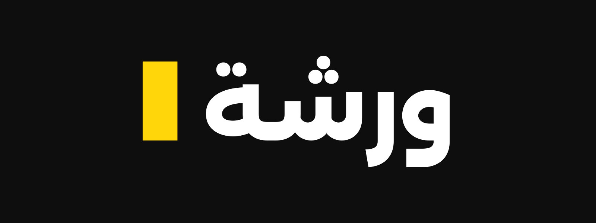
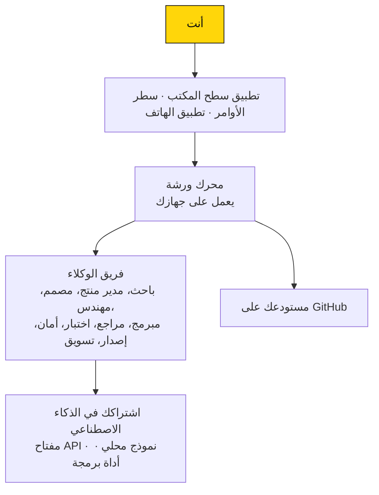
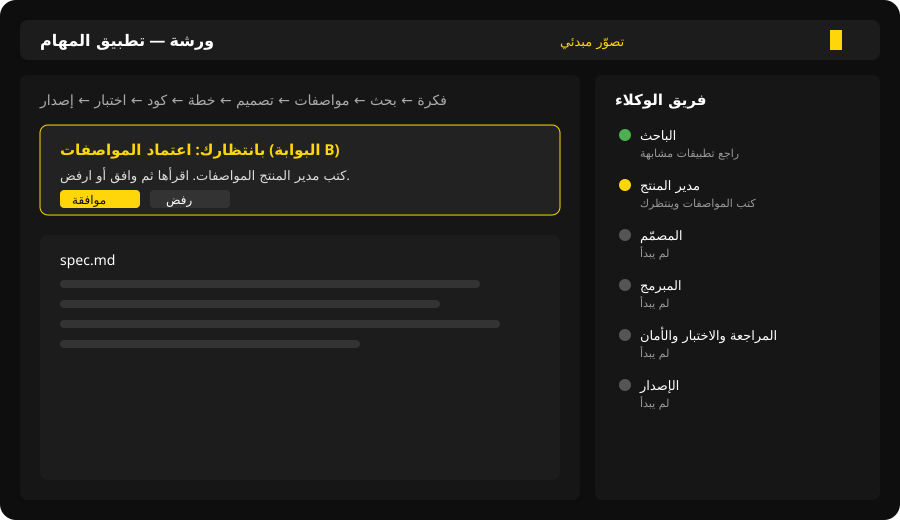

<a href="README.md">English</a> · <b>العربية</b>

  

<b>حوّل فكرة تطبيقك إلى منتج حقيقي، مع فريق من وكلاء الذكاء الاصطناعي، والقرار دائمًا بيدك.</b>

  
  

> [!WARNING]
> **الحالة: في مرحلة التطوير المبكر، وليست جاهزة للاستخدام بعد.** لا يوجد إصدار للتحميل حتى الآن، وكل ما في هذه الصفحة يشرح كيف <b>نخطط</b> أن تعمل ورشة. راجع <a href="#خارطة-الطريق">خارطة الطريق</a>.

## ما هي ورشة؟

ورشة تطبيق يعمل كأنه فريق برمجة صغير. تكتب فكرتك بكلمات بسيطة، بالعربية أو بالإنجليزية، فيتولى فريق من وكلاء الذكاء الاصطناعي دراستها وكتابة مواصفاتها وتصميمها والتخطيط لها، ثم كتابة الكود واختباره ومراجعته وتجهيز الإصدار. وأنت توافق على كل خطوة مهمة.

- **العربية أولًا:** واجهة عربية كاملة من اليمين إلى اليسار، ومعها الإنجليزية.
- **أنت صاحب القرار:** لا شيء يُدمج أو يُنشر إلا بموافقتك.
- **استخدم اشتراكك الحالي:** تربط خدمة الذكاء الاصطناعي التي تملكها بالفعل، بدل أن تشترك في خدمة جديدة.
- **تابع من أي مكان:** راقب سير العمل ووافق على الخطوات من هاتفك.

## لمن صُممت ورشة؟

- لمن عنده فكرة تطبيق ولا يعرف البرمجة.
- لرواد الأعمال والفرق الصغيرة الذين يريدون الوصول إلى نسخة أولى أسرع.
- للمبرمجين الذين يريدون فريقًا ينجز العمل المتكرر بينما يتفرغون هم للمراجعة.

## الرحلة من الفكرة إلى الإصدار

الخطوات الصفراء هي **البوابات**: يتوقف عندها الوكلاء وينتظرون قرارك.

```mermaid
flowchart RL
  I([فكرتك]) --> GA{{البوابة A<br/>اعتماد الفكرة}}
  GA --> R[البحث] --> S[المواصفات]
  S --> GB{{البوابة B<br/>اعتماد المواصفات}}
  GB -- رفض --> S
  GB --> D[التصميم] --> P[الخطة] --> C[الكود]
  C --> T[الاختبار والمراجعة والأمان]
  T --> GC{{البوابة C<br/>اعتماد الدمج}}
  GC --> REL[الإصدار] --> L[مسودات الإطلاق]
  L --> GD{{البوابة D<br/>اعتماد النشر}}
  GD --> F[الملاحظات] -.-> I
  classDef gate fill:#FFD60A,stroke:#0E0E0E,color:#0E0E0E;
  class GA,GB,GC,GD gate;
```

## كيف تتكامل الأجزاء؟

## كيف ستبدو؟

<i>تصوّر مبدئي فقط، فالتطبيق الحقيقي لم يُبنَ بعد.</i>

## طريقة الاستخدام (المخطط لها)

1. **التثبيت:** تحمّل برنامج التثبيت لويندوز أو ماك أو لينكس من صفحة الإصدارات *(في مرحلة لاحقة)*.
2. **اختيار اللغة:** تختار العربية أو الإنجليزية عند أول تشغيل.
3. **ربط الذكاء الاصطناعي:** تضيف ما لديك بالفعل: مفتاح API (مثل OpenAI أو Anthropic أو Gemini أو DeepSeek أو OpenRouter أو Azure)، أو نموذجًا يعمل على جهازك (Ollama أو LM Studio)، أو أداة برمجة رسمية تستخدمها (Claude Code أو Codex CLI أو Gemini CLI أو Cursor CLI). تُحفظ المفاتيح في الخزنة الآمنة لنظام التشغيل.
4. **ربط GitHub:** حتى تنشئ ورشة مستودعًا لمشروعك.
5. **بدء مشروع:** تكتب فكرتك في جملة أو اثنتين، مثل: *«تطبيق مهام يعمل دون إنترنت».*
6. **متابعة الفريق:** تعرض اللوحة الجانبية كل وكيل وملخصًا قصيرًا وبسيطًا لما أنجزه، وتوضح لوحة المشروع المرحلة التي وصل إليها.
7. **الموافقة أو الرفض عند كل بوابة:** تقرأ ما أنتجه الوكلاء (ملخص الفكرة، المواصفات، تعديلات الكود، نصوص الإطلاق)، ثم توافق ليستمر العمل، أو ترفض مع ذكر السبب باختصار فيعيد الوكلاء العمل عليه.
8. **المتابعة من الهاتف:** تمسح رمز QR من تطبيق سطح المكتب لربط هاتفك، فترى الحالة لحظة بلحظة، وتحادث الوكيل الحالي، وتصلك الإشعارات، وتوافق على البوابات.
9. **استلام الإصدار:** في النهاية يكون لديك مستودع على GitHub فيه الكود، والفحوصات ناجحة، ومسودة إصدار، ومسودات لنصوص المتاجر. ورشة لا تنشر أي شيء من تلقاء نفسها.

تفضّل سطر الأوامر؟ ستتوفر الخطوات نفسها عبر الأمر `warsha`، مثل `warsha new "فكرتك"` و`warsha status` و`warsha approve` و`warsha pair`.

## خارطة الطريق

الطريق إلى النسخة الأولى **v0.1.0**، دون مواعيد محددة.

| المرحلة | ما تقدمه | الحالة |
|---|---|---|
| M0 | أساس المشروع والفحوصات التلقائية | 🟡 قيد العمل |
| M1 | المحرك الخلفي وحفظ الحالة | ⚪ مخطط لها |
| M2 | ربط مزودي الذكاء الاصطناعي والميزانية وتتبع التكلفة | ⚪ مخطط لها |
| M3 | مسار الوكلاء وبوابات الموافقة | ⚪ مخطط لها |
| M4 | أداة سطر الأوامر `warsha` | ⚪ مخطط لها |
| M5 | تطبيق سطح المكتب | ⚪ مخطط لها |
| M6 | تطبيق الهاتف مع ربط آمن | ⚪ مخطط لها |
| M7 | وكلاء البرمجة والتكامل مع GitHub | ⚪ مخطط لها |
| M8 | العربية والإنجليزية بالكامل، والاتجاه من اليمين إلى اليسار | ⚪ مخطط لها |
| M9 | برامج التثبيت والإصدارات والتوثيق | ⚪ مخطط لها |

## أسئلة شائعة

**كم تكلّف؟**
ورشة نفسها لا تطلب منك شيئًا. أنت تستخدم مزود الذكاء الاصطناعي الخاص بك، فأي تكلفة هي ما تدفعه له أصلًا. وستعرض ورشة عدّادًا للتكلفة، وتتيح لك تحديد ميزانية تتوقف عندها قبل تجاوزها.

**أين تُحفظ بياناتي؟**
على جهازك. المشاريع والسجل والملفات تبقى محليًا، وكود مشروعك يذهب إلى حسابك أنت على GitHub. المفاتيح تُحفظ في خزنة نظام التشغيل فقط، والاتصال بالهاتف مشفّر من طرف إلى طرف، فلا يستطيع الخادم الوسيط قراءته.

**ما الاشتراكات التي تعمل معها؟**
المخطط له: مفاتيح API من OpenAI وAnthropic وGemini وDeepSeek وOpenRouter وAzure، والنماذج المحلية عبر Ollama أو LM Studio، وأدوات البرمجة الرسمية مثل Claude Code وCodex CLI وGemini CLI وCursor CLI. ورشة تتصل فقط بالطرق الرسمية المسموح بها.

**هل هي مجانية؟**
نعم، للاستخدام الشخصي وكل استخدام غير تجاري.

**ماذا تعني الرخصة ببساطة؟**
تستخدم ورشة رخصة PolyForm Noncommercial 1.0.0. يمكنك قراءة الكود واستخدامه وتعديله ومشاركته، بشرط ألا يكون ذلك لغرض تجاري. وللاستخدام التجاري تواصل مع Athar Studio على contact@atharapp.download. لهذا تُعد ورشة «مفتوحة المصدر للاطلاع»، وليست مفتوحة المصدر بالمعنى الرسمي.

**هل أستطيع استخدامها الآن؟**
ليس بعد. تابع هذا المستودع لتعرف موعد صدور النسخة الأولى.

---

للمطورين: طريقة البناء والبنية والمساهمة موجودة في [docs/DEVELOPERS.md](docs/DEVELOPERS.md).

من صنع **Athar Studio**. الرخصة: [PolyForm Noncommercial 1.0.0](LICENSE).

