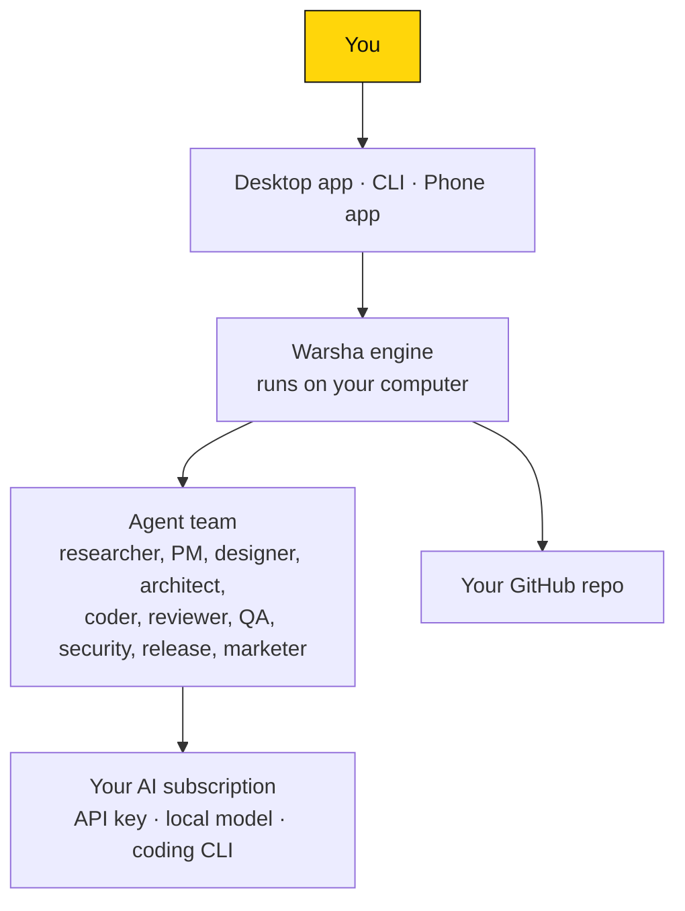
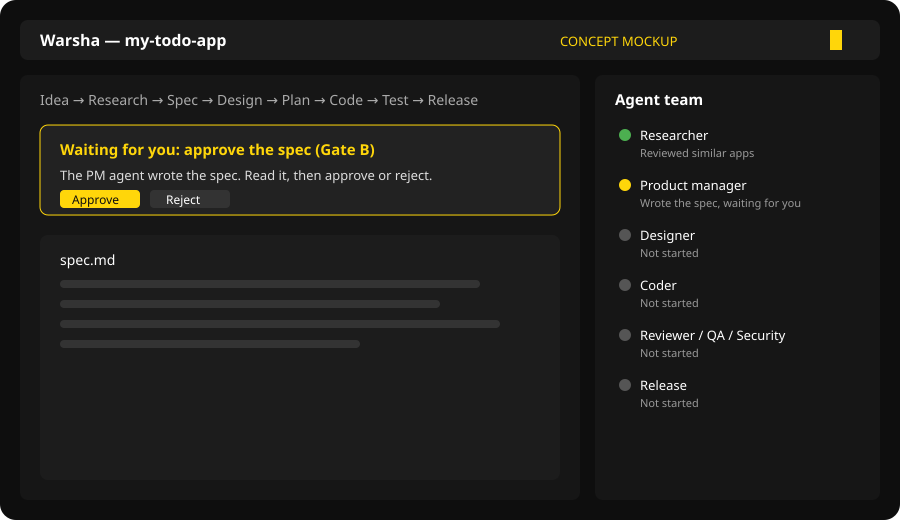

<b>English</b> · <a href="README.ar.md">العربية</a>

  

<b>Turn your app idea into a working product, with a team of AI agents and you in charge.</b>

  
  

> [!WARNING]
> **Status: early development, not ready to use yet.** There is no release to download. Everything below describes how Warsha is *planned* to work. See the [Roadmap](#roadmap).

## What is Warsha?

Warsha ("workshop" in Arabic) is an app that works like a small software team. You describe an idea in plain words, in Arabic or English. A team of AI agents researches it, writes the spec, designs, plans, writes the code, tests and reviews it, and prepares a release, while you approve each important step.

- **Arabic first.** Full Arabic interface (right to left) and English.
- **You stay in control.** Nothing is merged, published or posted without your approval.
- **Use the AI you already pay for.** Plug in your own AI provider instead of buying a new subscription.
- **Follow from anywhere.** Watch progress and approve steps from your phone.

## Who is it for?

- People with an app idea who are not programmers.
- Founders and small teams who want to go from idea to a first version faster.
- Developers who want a team of agents doing the routine work while they review.

## The journey: from idea to release

The yellow steps are **gates**: the agents stop and wait for your decision.

```mermaid
flowchart LR
  I([Your idea]) --> GA{{Gate A<br/>approve idea}}
  GA --> R[Research] --> S[Spec]
  S --> GB{{Gate B<br/>approve spec}}
  GB -- reject --> S
  GB --> D[Design] --> P[Plan] --> C[Code]
  C --> T[Test · Review · Security]
  T --> GC{{Gate C<br/>approve merge}}
  GC --> REL[Release] --> L[Launch drafts]
  L --> GD{{Gate D<br/>approve publish}}
  GD --> F[Feedback] -.-> I
  classDef gate fill:#FFD60A,stroke:#0E0E0E,color:#0E0E0E;
  class GA,GB,GC,GD gate;
```

## How the pieces fit together

## What it will look like

<i>Concept mockup only. The real app is not built yet.</i>

## How to use it (planned)

1. **Install.** Download the installer for Windows, macOS or Linux from the Releases page *(coming in a later milestone)*.
2. **Pick your language** (Arabic or English) when the app opens for the first time.
3. **Connect your AI.** Add the AI you already have: an API key (OpenAI, Anthropic, Gemini, DeepSeek, OpenRouter, Azure), a model running on your own computer (Ollama, LM Studio), or an official coding tool you already use (Claude Code, Codex CLI, Gemini CLI, Cursor CLI). Keys are kept in your system's secure keychain.
4. **Connect GitHub** so Warsha can create a repository for your project.
5. **Start a project.** Write your idea in a sentence or two, for example: *"A to-do app that works offline."*
6. **Follow the team.** The side panel shows every agent and a short, simple summary of what it did. The board shows which stage your project is in.
7. **Approve or reject at each gate.** Read what the agents produced (idea summary, spec, code changes, launch texts). Approve to continue, or reject with a short reason and the agents will rework it.
8. **Follow from your phone.** Scan a QR code from the desktop app to pair your phone. You can see live status, chat with the current agent, get notifications, and approve gates.
9. **Get your release.** At the end you have a GitHub repository with the code, passing checks, a draft release and draft store texts. Warsha never publishes anything by itself.

Prefer the terminal? The same steps will be available with the `warsha` command (`warsha new "your idea"`, `warsha status`, `warsha approve`, `warsha pair`).

## Roadmap

Toward the first version, **v0.1.0**. No dates are set.

| Milestone | What it delivers | Status |
|---|---|---|
| M0 | Project foundation and automated checks | 🟡 In progress |
| M1 | Background engine and saved state | ⚪ Planned |
| M2 | Connecting AI providers, budgets and cost tracking | ⚪ Planned |
| M3 | The agent pipeline and approval gates | ⚪ Planned |
| M4 | Command-line tool (`warsha`) | ⚪ Planned |
| M5 | Desktop app | ⚪ Planned |
| M6 | Phone app with secure pairing | ⚪ Planned |
| M7 | Coding agents and GitHub integration | ⚪ Planned |
| M8 | Full Arabic and English, right-to-left layout | ⚪ Planned |
| M9 | Installers, releases and documentation | ⚪ Planned |

## FAQ

**How much does it cost?**
Warsha itself does not charge you. You use your own AI provider, so any AI cost is what you already pay that provider. Warsha will show a cost meter and let you set a budget so it pauses before going over.

**Where does my data live?**
On your computer. Projects, history and files stay locally, and your project code goes to your own GitHub account. Keys are stored only in your system keychain. Phone connections are end-to-end encrypted, so the relay in between cannot read them.

**Which AI subscriptions work?**
Planned: API keys from OpenAI, Anthropic, Gemini, DeepSeek, OpenRouter and Azure; local models through Ollama or LM Studio; and official coding tools like Claude Code, Codex CLI, Gemini CLI and Cursor CLI. Warsha only uses official, permitted ways to connect.

**Is it free?**
Yes, for personal and other noncommercial use.

**What does the license mean in plain words?**
Warsha uses the PolyForm Noncommercial 1.0.0 license. You can read the code, use it, change it and share it, as long as it is not for commercial purposes. For commercial use, contact Athar Studio at contact@atharapp.download. This makes Warsha "source-available", not open source in the official sense.

**Can I use it now?**
Not yet. Star or watch this repository to know when the first release is out.

---

Developers: build instructions, architecture and contributing are in [docs/DEVELOPERS.md](docs/DEVELOPERS.md).

Made by **Athar Studio**. License: [PolyForm Noncommercial 1.0.0](LICENSE).
