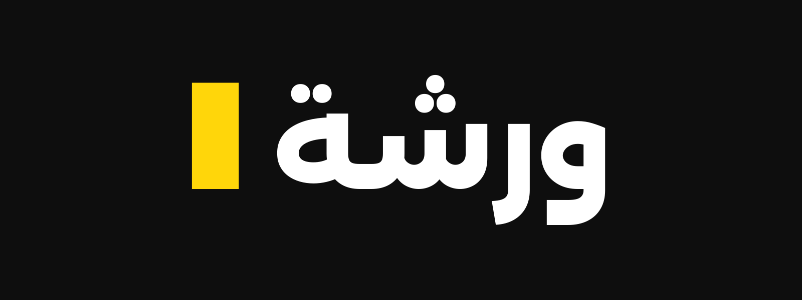
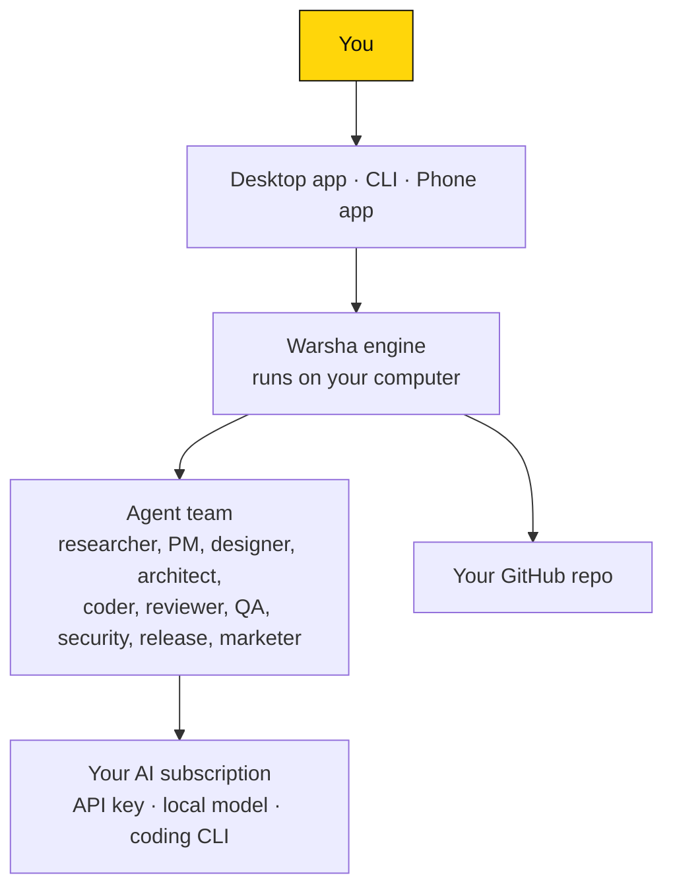
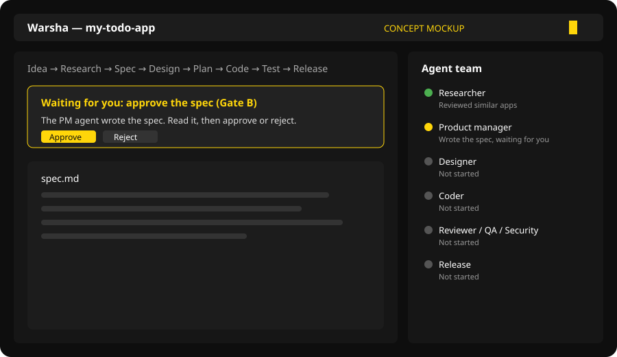

<b>English</b> · <a href="README.ar.md">العربية</a>

  

<b>Turn your app idea into a working product, with a team of AI agents and you in charge.</b>

  
  
  
  

  <b>Website:</b> <a href="https://warsha-dev.pages.dev/">warsha-dev.pages.dev</a> ·
  <b>Download:</b> <a href="https://github.com/athar-studios/warsha/releases/tag/v0.3.1">Warsha 0.3.1</a>

> [!WARNING]
> **Status: version 0.3.1 is published — and it is an early preview.** You can
> [download it](https://github.com/athar-studios/warsha/releases/tag/v0.3.1) for Windows, macOS and
> Linux. Please know before you install: the installers are **not signed yet**, and there is **no
> in-app auto-update yet** — you will download the next version by hand. See
> [Verified today](#verified-today) and the [Roadmap](#roadmap).

## What is Warsha?

Warsha ("workshop" in Arabic) is a local-first desktop app that works like a small software team. You describe an idea in plain words, in Arabic or English. A team of AI agents researches it, writes the spec, designs, plans, writes the code, tests and reviews it, and prepares a release, while you approve each important step. Everything runs on your own computer: your projects, history and keys stay on your machine.

- **Arabic first.** Full Arabic interface (right to left) and English.
- **You stay in control.** Nothing is merged, published or posted without your approval.
- **Use the AI you already pay for.** Plug in your own AI provider instead of buying a new subscription.
- **Follow from anywhere.** Watch progress and approve steps from your phone.

## Download

**[Warsha 0.3.1 — download page](https://github.com/athar-studios/warsha/releases/tag/v0.3.1)**

All builds are 64-bit (x86_64 / amd64):

| Your system | File to download |
|---|---|
| Windows | `Warsha_0.3.1_x64-setup.exe` (or the `.msi` installer) |
| macOS (Intel) | `Warsha_0.3.1_x64.dmg` |
| Linux | `Warsha_0.3.1_amd64.AppImage` (portable), `.deb` (Debian/Ubuntu), or `.rpm` (Fedora/RHEL) |
| Command line only | the standalone `warsha` and `warshad` binaries for Linux, macOS and Windows |

The installers are **not signed yet**, so Windows and macOS may warn you during install — that is
expected for this release. There is **no automatic update yet**: when a new version comes out,
download it again from the [releases page](https://github.com/athar-studios/warsha/releases).
You can check your download against the fingerprints in `checksums.sha256` on the release page.

Prefer to build it yourself? Building from source is documented in
[docs/DEVELOPERS.md](docs/DEVELOPERS.md).

## Who is it for?

- People with an app idea who are not programmers.
- Founders and small teams who want to go from idea to a first version faster.
- Developers who want a team of agents doing the routine work while they review.

## Three views, one app

The same work, shown three ways — switch at any time:

- **Simple** — a secretary-style view. You talk to one assistant, see plain summaries, and only
  make decisions.
- **Factory** — a top-down, game-like factory floor. Your agents sit at their stations; click one
  to see what it is doing and what it did last.
- **Developers** — dense detail for people who want it all: per-agent and per-session activity,
  tokens, speed, and estimated cost.

Runs themselves have their own modes — Plan, Agent, Ask, and **Swarm**, which lets several agents
work in parallel in isolated worktrees. Swarm is **off by default** (up to 20 agents, 4 unless you
change it).

## The journey: from idea to release

The yellow steps are **gates**: the agents stop and wait for your decision.

```mermaid
flowchart LR
  I([Your idea]) --> GA{{Gate A<br/>approve idea}}
  GA --> R[Research] --> S[Spec]
  S --> GB{{Gate B<br/>approve spec}}
  GB -- reject --> S
  GB --> D[Design] --> P[Plan] --> C[Code]
  C --> T[Test · Review · Security]
  T --> GC{{Gate C<br/>approve merge}}
  GC --> REL[Release] --> L[Launch drafts]
  L --> GD{{Gate D<br/>approve publish}}
  GD --> F[Feedback] -.-> I
  classDef gate fill:#FFD60A,stroke:#0E0E0E,color:#0E0E0E;
  class GA,GB,GC,GD gate;
```

## How the pieces fit together

## What it will look like

<i>Concept mockup of the shipped layout — not a screenshot of the running app.</i>

## Quick start

1. **Download and install.** Get the file for your system from the
   [0.3.1 download page](https://github.com/athar-studios/warsha/releases/tag/v0.3.1) and run it.
   The installers are unsigned, so your system may ask you to confirm before installing.
2. **Pick your language** (Arabic or English) when the app opens for the first time.
3. **Connect your AI.** Add the AI you already have: an API key — one-click defaults for OpenRouter, DeepSeek, Kimi, GLM and Qwen, or any other endpoint (OpenAI, Anthropic) entered by its own URL — or a model running on your own computer (Ollama, LM Studio; the local adapter ignores the key field, but the form still asks for one). Official coding tools you already use (Claude Code, Codex CLI, Gemini CLI, Cursor CLI) are detected on your PATH but not yet driven by the pipeline. Keys are kept in your system's secure keychain — see the [FAQ](#which-ai-subscriptions-work) for what does and does not work today.
4. **Connect GitHub.** Give Warsha a GitHub token so it can prepare a repository for your project. The GitHub
   client is in the code (`crates/warsha-git`), but no screen or command drives it yet, so nothing creates a
   repository, opens an issue or opens a pull request today.
5. **Start a project.** Write your idea in a sentence or two, for example: *"A to-do app that works offline."*
6. **Follow the team.** The side panel shows every agent and a short, simple summary of what it did. The board shows which stage your project is in.
7. **Approve or reject at each gate.** Read what the agents produced (idea summary, spec, code changes, launch texts). Approve to continue, or reject with a short reason and the agents will rework it.
8. **Follow from your phone.** Scan a QR code from the desktop app to pair your phone. You can see live status,
   chat with the current agent, and approve gates. The PWA **does** register an offline shell service worker:
   the production build emits `dist/sw.js` and `registerShellWorker` registers it, so the bench still opens
   with no network. It caches the app shell only, never a daemon response. It requests **no push permission**,
   so there are no phone notifications and nothing reaches your phone by itself — you have to open it.
9. **Get your release.** The end state the pipeline is built for: a GitHub repository with the code, passing checks, a draft release and draft store texts. GitHub automation is not wired yet (see step 4), so today that last hop is done by hand; Warsha never publishes anything by itself.

Prefer the terminal? The `warsha` command exists today (`warsha new "your idea"`, `warsha status`,
`warsha approve <run> <gate>`, `warsha pair <qr-code>`). It talks to the `warshad` daemon, so start that first —
without it every command answers `Not connected to daemon`. The exact verbs and flags are in the
[quickstart](docs/src/quickstart.md).

## Verified today

Measured on 2026-11-22, during the checks that gated the 0.3.1 release:

| Check | Result |
|---|---|
| Rust tests (workspace) | 1,368 passed, 0 failed, 12 ignored |
| TypeScript suites (desktop, remote, client, UI, i18n, crypto) | all passed — 665 + 229 + 200 + 383 + 58 + 22 |
| Format, lint, types, architecture and wire-contract checks | passed |

This does **not** cover: the end-to-end encrypted relay is not implemented; no Android APK is built
in this tree; and the installers are unsigned (see [Download](#download)).

## Roadmap

Warsha is versioned **0.3.1** — the desktop app and the Rust crates alike — and tagged
[v0.3.1](https://github.com/athar-studios/warsha/releases/tag/v0.3.1). No dates are set.

| Milestone | What it delivers | Status |
|---|---|---|
| M0 | Project foundation and automated checks | ✅ Delivered |
| M1 | Background engine and saved state | ✅ Delivered |
| M2 | Connecting AI providers, budgets and cost tracking | ✅ Delivered |
| M3 | The agent pipeline and approval gates | ✅ Delivered |
| M4 | Command-line tool (`warsha`) | ✅ Delivered |
| M5 | Desktop app | ✅ Delivered on Windows |
| M6 | Phone app with secure pairing | 🟡 Pairing delivered; the end-to-end relay is not implemented |
| M7 | Coding agents and GitHub integration | 🟡 Backends delivered; the GitHub client exists but no screen or command drives it |
| M8 | Full Arabic and English, right-to-left layout | ✅ Delivered |
| M9 | Installers, releases and documentation | ✅ 0.3.1 published on 2026-11-22 with installers for Windows, macOS and Linux — unsigned; signing and in-app updates are the next steps |
| M10 | Orchestrator agent and the discovery interview | ✅ Delivered |
| M11 | Skills system and per-role packs | ✅ Delivered |
| M12 | MCP servers and the skill/MCP scout | ✅ Delivered |
| M13 | Desktop app, Simple / Factory / Developers view modes | ✅ Delivered |
| M14 | Agent safety and quality: guardrails, model router, traces, evals | ✅ Delivered |
| M15 | Marketing, social and launch assets | ✅ Delivered |
| M16 | Continuous development loop: updates, routines, automations | ✅ Delivered; owner-only steps remain (updater keys, Renovate app) |
| M17 | Post-launch care: crash reports, store reviews, daily summary | ✅ Delivered; no collector, no store client, no push |
| M18 | Agent workflow: Plan/Agent modes, mentions, compaction, compression | ✅ Delivered; mentions carry targets, not file contents |
| M19 | Backend kit: PocketBase/Supabase definition layer and export | ✅ Delivered; not yet driven through MCP |
| M20 | Foundations: architecture rules, design tokens, caches, run modes | 🟡 Delivered in batches; the foundation and follow-up batches are still landing |
| Wave 2 | Full-stack software factory: harnesses, skills, plugins, connectors, files, dual-mode UI | ✅ Delivered |

## FAQ

**How much does it cost?**
Warsha itself does not charge you. You use your own AI provider, so any AI cost is what you already pay that provider. Warsha will show a cost meter and let you set a budget so it pauses before going over.

**Where does my data live?**
On your computer. Projects, history and files stay locally, in a plain SQLite file you own. Keys you add in the
app are stored only in your system keychain, never in that file. The phone app reaches the daemon over your own
network with the daemon's access token, so on anything but your machine's loopback address you decide what
protects that hop (for example your own HTTPS proxy or VPN): the daemon serves no TLS itself, and the end-to-end
encrypted relay channel it was designed to use is not implemented yet — "the relay cannot read your messages" is
a design goal, not today's fact.

**Which AI subscriptions work?**
What works today, from `crates/warsha-providers/src/` and the daemon's provider factory (`crates/warshad/src/providers.rs:149-185`):

- **Any OpenAI-compatible endpoint with an API key.** The adapter takes a base URL and posts to `{base}/chat/completions` with a bearer token. The setup wizard ships a default URL and model for **OpenRouter, DeepSeek, Kimi (Moonshot), GLM (Zhipu) and Qwen (DashScope)**, plus a `custom` row for any other URL — which is how OpenAI itself and any compatible gateway are reached.
- **Anthropic (Claude)** through its own messages API, and **a local Ollama or LM Studio server**, which needs no real key — its adapter ignores the key field, though the add form still asks for one.
- **The `WARSHA_LLM_*` environment path** for an OpenAI-compatible endpoint, used when a role has no routing. With no key, a deterministic fake provider runs the whole pipeline offline. This path reads its key from the environment, so it is the one connection whose key is not in the keychain — set the base URL explicitly before exporting a key.
- **Official coding tools as separate backends**, not chat providers: Claude Code, Codex CLI, Gemini CLI, Cursor CLI, opencode and OpenHands. The daemon detects each one on your PATH at start-up, but their adapters are still being built: an install is recorded, not yet handed coding work.

What does not: **Google Gemini has no native adapter.** The live factory recognises three protocols — OpenAI-compatible, Anthropic and Ollama — so a `gemini` row is treated as a custom OpenAI-compatible endpoint and needs a URL that speaks that protocol; Gemini's own API is not implemented. **Azure OpenAI** has no native adapter either: it is reached the same way, so it works only where the endpoint accepts a bearer token at `{base}/chat/completions`, not through Azure's deployment-scoped `api-key` form. Warsha only uses official, permitted ways to connect, and every key you add in the app stays in your system keychain.

**Is it free?**
Yes, for personal and other noncommercial use.

**What does the license mean in plain words?**
Warsha uses the PolyForm Noncommercial 1.0.0 license. You can read the code, use it, change it and share it, as long as it is not for commercial purposes. For commercial use, please open an issue on this repository to reach Athar Studio. This makes Warsha "source-available", not open source in the official sense.

**Can I use it now?**
Yes — [download 0.3.1](https://github.com/athar-studios/warsha/releases/tag/v0.3.1) for Windows, macOS
or Linux. The installers are unsigned and there is no auto-update yet, so you will download the next
version by hand. You can also build it from source — see [docs/DEVELOPERS.md](docs/DEVELOPERS.md).

---

Developers: build instructions, architecture and contributing are in [docs/DEVELOPERS.md](docs/DEVELOPERS.md).

**Website:** https://warsha-dev.pages.dev/

Made by **Athar Studio**. License: [PolyForm Noncommercial 1.0.0](LICENSE).
