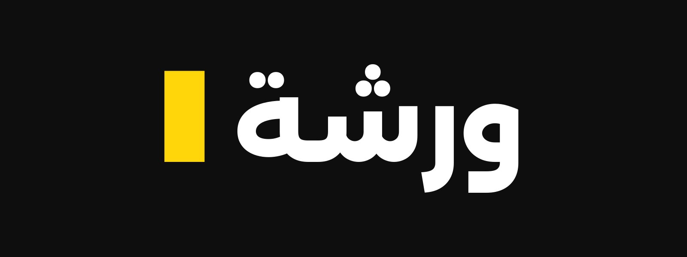
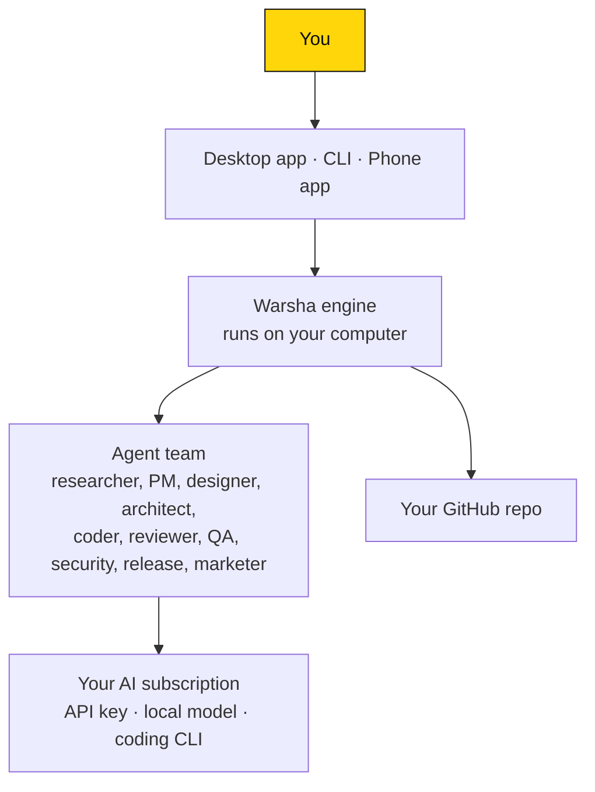
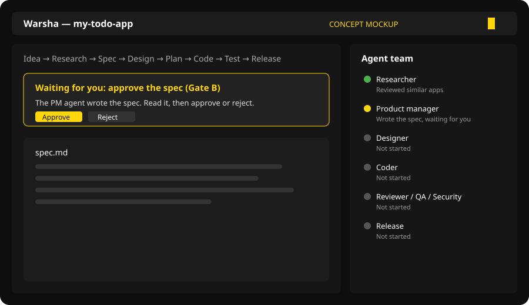

<b>English</b> · <a href="README.ar.md">العربية</a>

  

<b>Turn your app idea into a working product, with a team of AI agents and you in charge.</b>

  
  

> [!WARNING]
> **Status: built and verified locally; no published release.** The daemon, the desktop app and the phone
> app build and run from source, and the automated suites pass: 725 Rust tests, 1001 TypeScript tests and
> 785 Playwright end-to-end cases. `warsha-desktop.exe --self-check` passes 11 of 11 checks, including a
> full project → run → Gate A → advance cycle on a zero-key provider. There is still **no release to
> download**: nothing is tagged or published. See [Verified today](#verified-today) and the
> [Roadmap](#roadmap).

## What is Warsha?

Warsha ("workshop" in Arabic) is an app that works like a small software team. You describe an idea in plain words, in Arabic or English. A team of AI agents researches it, writes the spec, designs, plans, writes the code, tests and reviews it, and prepares a release, while you approve each important step.

- **Arabic first.** Full Arabic interface (right to left) and English.
- **You stay in control.** Nothing is merged, published or posted without your approval.
- **Use the AI you already pay for.** Plug in your own AI provider instead of buying a new subscription.
- **Follow from anywhere.** Watch progress and approve steps from your phone.

## Who is it for?

- People with an app idea who are not programmers.
- Founders and small teams who want to go from idea to a first version faster.
- Developers who want a team of agents doing the routine work while they review.

## The journey: from idea to release

The yellow steps are **gates**: the agents stop and wait for your decision.

```mermaid
flowchart LR
  I([Your idea]) --> GA{{Gate A<br/>approve idea}}
  GA --> R[Research] --> S[Spec]
  S --> GB{{Gate B<br/>approve spec}}
  GB -- reject --> S
  GB --> D[Design] --> P[Plan] --> C[Code]
  C --> T[Test · Review · Security]
  T --> GC{{Gate C<br/>approve merge}}
  GC --> REL[Release] --> L[Launch drafts]
  L --> GD{{Gate D<br/>approve publish}}
  GD --> F[Feedback] -.-> I
  classDef gate fill:#FFD60A,stroke:#0E0E0E,color:#0E0E0E;
  class GA,GB,GC,GD gate;
```

## How the pieces fit together

## What it will look like

<i>Concept mockup of the shipped layout — not a screenshot of the running app.</i>

## How to use it

Nothing is published for download yet, so the first step is a build you make yourself. Building from
source is documented in [docs/DEVELOPERS.md](docs/DEVELOPERS.md), and the same release build produces an
installer bundle.

1. **Install from your own build.** Build the release bundle on your platform and run its installer.
   *(Verified on Windows; macOS and Linux bundles come from the same command but were not built in this
   round. No download is published — see the [Roadmap](#roadmap).)*
2. **Pick your language** (Arabic or English) when the app opens for the first time.
3. **Connect your AI.** Add the AI you already have: an API key (OpenAI, Anthropic, Gemini, DeepSeek, OpenRouter, Azure), a model running on your own computer (Ollama, LM Studio), or an official coding tool you already use (Claude Code, Codex CLI, Gemini CLI, Cursor CLI). Keys are kept in your system's secure keychain.
4. **Connect GitHub.** Give Warsha a GitHub token so it can prepare a repository for your project. The GitHub
   client is in the code (`crates/warsha-git`), but no screen or command drives it yet, so nothing creates a
   repository, opens an issue or opens a pull request today.
5. **Start a project.** Write your idea in a sentence or two, for example: *"A to-do app that works offline."*
6. **Follow the team.** The side panel shows every agent and a short, simple summary of what it did. The board shows which stage your project is in.
7. **Approve or reject at each gate.** Read what the agents produced (idea summary, spec, code changes, launch texts). Approve to continue, or reject with a short reason and the agents will rework it.
8. **Follow from your phone.** Scan a QR code from the desktop app to pair your phone. You can see live status,
   chat with the current agent, and approve gates. There are no phone notifications: the mobile app registers
   no service worker and requests no push permission, so nothing reaches your phone by itself — you have to
   open it.
9. **Get your release.** The end state the pipeline is built for: a GitHub repository with the code, passing checks, a draft release and draft store texts. GitHub automation is not wired yet (see step 4), so today that last hop is done by hand; Warsha never publishes anything by itself.

Prefer the terminal? The `warsha` command exists today (`warsha new "your idea"`, `warsha status`,
`warsha approve <run> <gate>`, `warsha pair <qr-code>`). It talks to the `warshad` daemon, so start that first —
without it every command answers `Not connected to daemon`. The exact verbs and flags are in the
[quickstart](docs/src/quickstart.md).

## Verified today

Measured on 2026-11-05–08 on a Windows host plus a Linux x86_64 capture host with pinned fonts:

| Gate | Command | Result |
|---|---|---|
| Rust tests | `cargo test --workspace --no-fail-fast` | 725 passed, 0 failed |
| TypeScript tests | `pnpm -r test` | 1001 passed |
| Lint, types and build | `pnpm -r lint` · `pnpm -r typecheck` · `pnpm -r build` | exit 0 for each |
| Accessibility | Playwright `screens.a11y` | 180 passed |
| UI states | Playwright `states` | 252 passed |
| Visual regression | Playwright `screens.visual` | 308 passed |
| Behavioral flows | Playwright `flows`, `layout`, `onboarding` | 45 passed |
| Desktop shell | `warsha-desktop.exe --self-check` | 11/11 PASS |

This does **not** cover: visual baselines were captured on Linux x86_64 only, so Windows and macOS rendering
is unverified; the end-to-end encrypted relay is not implemented; routine authoring and Backend Kit export
are not wired to their screens; and no Android APK is built in this tree.

## Roadmap

The desktop app is versioned **0.2.0** (`apps/desktop/src-tauri/tauri.conf.json`) and the Rust crates **0.1.0**
(`Cargo.toml`); neither is tagged and no version has been released. No dates are set.

| Milestone | What it delivers | Status |
|---|---|---|
| M0 | Project foundation and automated checks | ✅ Delivered |
| M1 | Background engine and saved state | ✅ Delivered |
| M2 | Connecting AI providers, budgets and cost tracking | ✅ Delivered |
| M3 | The agent pipeline and approval gates | ✅ Delivered |
| M4 | Command-line tool (`warsha`) | ✅ Delivered |
| M5 | Desktop app | ✅ Delivered on Windows |
| M6 | Phone app with secure pairing | 🟡 Pairing delivered; the end-to-end relay is not implemented |
| M7 | Coding agents and GitHub integration | 🟡 Backends delivered; the GitHub client exists but no screen or command drives it |
| M8 | Full Arabic and English, right-to-left layout | ✅ Delivered |
| M9 | Installers, releases and documentation | 🟡 A local installer is built; no published release |

## FAQ

**How much does it cost?**
Warsha itself does not charge you. You use your own AI provider, so any AI cost is what you already pay that provider. Warsha will show a cost meter and let you set a budget so it pauses before going over.

**Where does my data live?**
On your computer. Projects, history and files stay locally, in a plain SQLite file you own. Keys are stored only
in your system keychain, never in that file. The phone app reaches the daemon over your own network with the
daemon's access token, so on anything but your machine's loopback address you decide what protects that hop (for
example your own HTTPS proxy or VPN): the daemon serves no TLS itself, and the end-to-end encrypted relay channel
it was designed to use is not implemented yet, so the relay cannot read messages is a design goal, not today's fact.

**Which AI subscriptions work?**
Planned: API keys from OpenAI, Anthropic, Gemini, DeepSeek, OpenRouter and Azure; local models through Ollama or LM Studio; and official coding tools like Claude Code, Codex CLI, Gemini CLI and Cursor CLI. Warsha only uses official, permitted ways to connect.

**Is it free?**
Yes, for personal and other noncommercial use.

**What does the license mean in plain words?**
Warsha uses the PolyForm Noncommercial 1.0.0 license. You can read the code, use it, change it and share it, as long as it is not for commercial purposes. For commercial use, contact Athar Studio at contact@atharapp.download. *This address is a placeholder the owner has not confirmed — the published contact address is an owner decision, and Warsha currently publishes no verified one.* This makes Warsha "source-available", not open source in the official sense.

**Can I use it now?**
Not as a download. There is no published release, but you can build it from source today — see
[docs/DEVELOPERS.md](docs/DEVELOPERS.md). Watch this repository for the first release.

---

Developers: build instructions, architecture and contributing are in [docs/DEVELOPERS.md](docs/DEVELOPERS.md).

Made by **Athar Studio**. License: [PolyForm Noncommercial 1.0.0](LICENSE).
