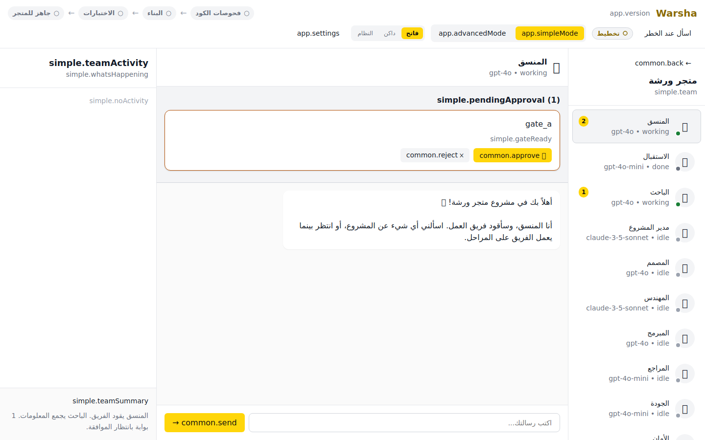
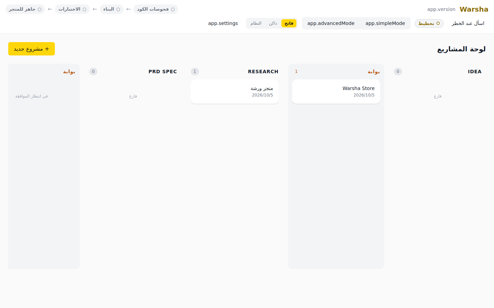
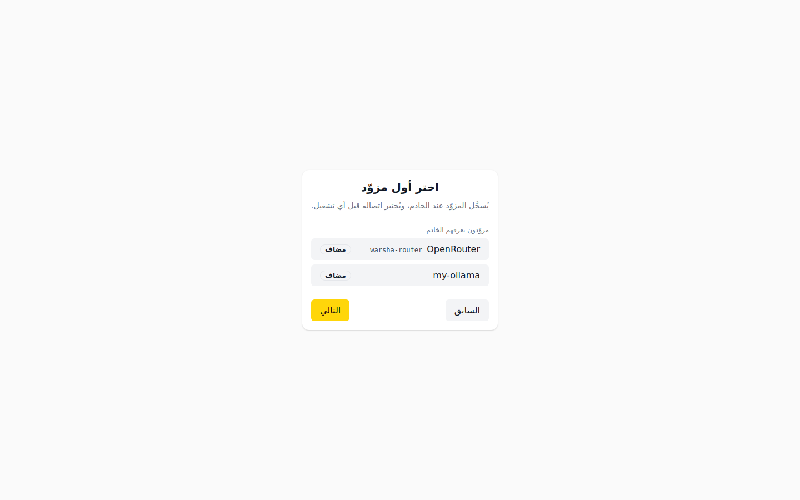

# ورشة · Warsha — Landing

<div dir="rtl" lang="ar" class="landing-page">

<div class="hero-container">
  <div class="hero-badge">مصنع برمجيات بالذكاء الاصطناعي، شيفرته متاحة للاطلاع · عربي أولاً</div>
  <h1 class="hero-title">حوّل فكرتك إلى تطبيق برمجي متكامل يعمل</h1>
  <p class="hero-subtitle">
    صِف فكرتك بالعربية أو الإنجليزية، ورشة تقود فريقاً متخصصاً من 12 وكيلاً لبناء واختبار تطبيقك عبر مسار مراحل محكم لا يتقدّم خطوة واحدة إلا بموافقتك أنت. محلي بالكامل على جهازك، بأمان تام ودون مشاركة مفاتيحك.
  </p>
  <div class="hero-actions">
    <a href="quickstart.md" class="btn btn-primary">🛠 ابنِ ورشة من المصدر — لا يوجد تنزيل جاهز بعد</a>
    <a href="user-guide.ar.md" class="btn btn-secondary">📖 دليل المستخدم بالعربية</a>
    <a href="first-run.md" class="btn btn-tertiary">إدخال مفتاح المزوّد أول مرة</a>
  </div>
</div>

---

## كيف تعمل ورشة؟ (رحلة التطوير في 3 خطوات)

<div class="journey-grid">
  <div class="journey-card">
    <div class="journey-step">1</div>
    <h3>صِف فكرتك (Intake & Discovery)</h3>
    <p>
      اكتب سطرين يصفان مشروعك. وكيل الفرز والاستقبال <code>Intake</code> يحاورك بأسئلة دقيقة لتوضيح الأهداف، النطاق، والقيود قبل كتابة سطر كود واحد.
    </p>
  </div>
  <div class="journey-card">
    <div class="journey-step">2</div>
    <h3>فريق عمل كامل تحت إشرافك (12 Agents & Gates)</h3>
    <p>
      يتولى فريق من 12 وكيلاً (مدير المنتج، المصمم، المعماري، المبرمج، المراجع، فاحص الجودة، الأمان...). كل مرحلة حساسة تتوقف عند بوابة موافقة بشرية <strong>(Gate A/B/C/D)</strong> ولا يُعتمد أي قرار تلقائياً.
    </p>
  </div>
  <div class="journey-card">
    <div class="journey-step">3</div>
    <h3>تطبيق حقيقي ومعاينة فورية (Code & Live Preview)</h3>
    <p>
      تُحفظ مخرجات كل مرحلة — ملخّص الفكرة والمواصفات والتصميم والخطة والكود والمراجعة — مع التشغيل وتُقرأ من
      التطبيق، ويمكن تشغيل خادم معاينة حية لمشروعك (<code>preview.start</code>). أما مستودع Git نظيف لكل مشروع فهو
      التصميم: طبقة Git موجودة (<code>crates/warsha-git</code>) لكن لا مرحلة ولا شاشة تستدعيها اليوم، فلا يُلتزم
      شيء ولا يُدفع عنك.
    </p>
  </div>
</div>

---

## لقطات حقيقية من واجهة البرنامج

<div class="screenshot-showcase">
  <div class="screenshot-item">
    
    <p class="screenshot-caption">شاشة الوضع البسيط: متابعة المحادثة الذكية وقائمة الوكلاء وحالتهم اللحظية أثناء التنفيذ.</p>
  </div>

  <div class="screenshot-item">
    
    <p class="screenshot-caption">لوحة المشاريع (Kanban): مسار المراحل الـ 14 وبطاقات بوابات الموافقة البشرية.</p>
  </div>

  <div class="screenshot-item">
    
    <p class="screenshot-caption">معالج الإعداد الأولي: اختيار المزوّد واختبار المفتاح وحفظه في خزانة نظام التشغيل بأمان.</p>
  </div>
</div>

---

## المزايا الأساسية

<div class="features-grid">
  <div class="feature-card">
    <div class="feature-icon">🛡️</div>
    <h3>أمان وخصوصية تامة</h3>
    <p>
      مفاتيحك وبياناتك لا تخرج من حاسوبك أبداً. الأسرار تُحفظ حصرياً في خزانة نظام التشغيل (OS Keychain)، ولا تُسجَّل في السجلات أو قواعد البيانات.
    </p>
  </div>

  <div class="feature-card">
    <div class="feature-icon">🌐</div>
    <h3>عربي أولاً بالكامل (RTL-First)</h3>
    <p>
      واجهة عربية أصيلة صُممت خصيصاً للمستخدم العربي من اليمين لليسار، مع دعم كامل للإنجليزية وتوليد كود وتوثيق ثنائي اللغة.
    </p>
  </div>

  <div class="feature-card">
    <div class="feature-icon">🔌</div>
    <h3>أحضر مزوّدك (BYO Provider)</h3>
    <p>
      تحكم كامل في ميزانيتك: ادعم DeepSeek, OpenAI, Anthropic, Qwen, Kimi أو النماذج المحلية تماماً عبر Ollama بلا تكلفة تشغيل.
    </p>
  </div>

  <div class="feature-card">
    <div class="feature-icon">🚪</div>
    <h3>4 بوابات موافقة بشرية (Human Gates)</h3>
    <p>
      لن يقوم أي وكيل بنشر كود أو إصدار نسخة أو نشر محتوى على الإنترنت دون نقرة موافقة صريحة منك. التحكم للمالك أولاً وأخيراً.
      وأفعال الدمج والنشر نفسها لا يقودها التطبيق بعد: طبقة GitHub غير موصولة بأي شاشة ولا بأي أمر.
    </p>
  </div>

  <div class="feature-card">
    <div class="feature-icon">💻</div>
    <h3>محلي أولاً (Local-First)</h3>
    <p>
      قاعدة البيانات (SQLite)، ومستودع Git، وعمليات البناء والتشغيل كلها تعمل محلياً على جهازك؛ لا اشتراكات إلزامية ولا سحابة وسيطة.
    </p>
  </div>

  <div class="feature-card">
    <div class="feature-icon">🧪</div>
    <h3>ضوابط معمارية، لا وضع محاكاة مجاني</h3>
    <p>
      توجد فحوصات جودة معمارية آلية تحكم حدود الحزم والاعتماديات (<code>scripts/check-arch.mjs</code>)، وتوجد نماذج
      محلية عبر Ollama بلا تكلفة استدعاء. أمّا «وضع المحاكاةฟรี بالكامل» فليس ميزة للمستخدم: مزوّد الاختبارات
      الوهمي يعيش في شيفرة Rust وفحوصاتها فقط، ولا يمكن اختياره من الواجهة ولا من سطر الأوامر.
    </p>
  </div>
</div>

---

## الوكلاء الاثنا عشر ومسار المراحل

مسار واضح من الفكرة حتى الإصدار عبر 14 مرحلة و4 بوابات:

```text
Idea → Gate A → Research → PRD Spec → Gate B → Design → Plan Tasks → Code
     → Review / QA / Security → Gate C → Release → Gate D → Launch Drafts → Feedback
```

| # | الوكيل | الدور | المسؤولية |
|---|--------|-------|-----------|
| 1 | الفرز | `Intake` | يحوّل الفكرة الخام إلى موجز منظّم وأسئلة اكتشاف |
| 2 | الباحث | `Researcher` | يجمع الأدلة والمقارنات والقيود قبل التخطيط |
| 3 | مدير المنتج | `PM` | يكتب وثيقة المتطلبات ويقسّمها إلى مهام قابلة للتنفيذ |
| 4 | المصمّم | `Designer` | يحدّد تدفّق التجربة والواجهات والهوية |
| 5 | المعماري | `Architect` | يختار البنية والمكوّنات وحدود كل جزء |
| 6 | المبرمج | `Coder` | ينفّذ المهام في فرع مستقل داخل بيئة معزولة |
| 7 | المراجع | `Reviewer` | يراجع الفروق والجودة قبل الدمج |
| 8 | ضمان الجودة | `QA` | يشغّل الاختبارات ويتحقّق من قبول المتطلبات |
| 9 | الأمان | `Security` | يفحص الأسرار والتبعيات والصلاحيات |
| 10 | الإصدار | `Release` | يجهّز الحزم والبصمات وملاحظات الإصدار |
| 11 | التسويق | `Marketer` | يكتب نصوص المتاجر ومحتوى الإطلاق |
| 12 | التغذية الراجعة | `Feedback` | يفرز الملاحظات والأخطاء ويقترح الخطة التالية |

---

## لمن ورشة … ولمن ليست؟

ورشة أداة لمالك منتج ومطوّر يريد نتائج حقيقية موثوقة:

- **مناسبة لك إذا كنت:** تريد مستودعاً حقيقياً بكود نظيف وتاريخ Git، تملك مفاتيحك أو تفضل تشغيل نماذج محلية مجاناً عبر Ollama، وتريد مراجعة واعتماد كل خطوة حساسة دون مفاجآت.
- **غير مناسبة لك إذا كنت:** تبحث عن أداة تنشر تلقائياً على الإنترنت بدون إذنك، أو تبحث عن خدمة سحابية تبيعك حصص نماذج باشتراكات، أو تريد توليد واجهات سريعة دون الاهتمام بجودة ومراجعة الكود.

---

## لا أرقام مزيفة (حقائق موثقة من المستودع)

نلتزم بالشفافية الكاملة: لا نضع تقييمات مجهولة، أو أرقام مستخدمين وهمية، أو وعوداً غير مثبتة برمجياً:

| الحقيقة | المصدر والبرهان البرمجي |
|---------|-------------------------|
| 12 وكيلاً | 12 ملف توجيه متخصص في `crates/warsha-pipeline/src/prompts/` |
| 14 مرحلة | معرّفة بدقة في `Stage::all()` في `crates/warsha-core/src/lib.rs` |
| 4 بوابات بشرية | بوابات Gate A وGate B وGate C وGate D غير قابلة للتجاوز الآلي |
| 3 أنظمة تشغيل في مصفوفة CI | ويندوز وmacOS ولينكس معرّفة في `.github/workflows/ci.yml` — مصفوفة معلنة لا نسخة مُنتجة: لا وسم ولا إصدار لأي نظام، والـ CI لا يعمل إلا على ما يستهدف `main` |
| تخزين أسرار OS Keychain | مستودع آمن يعتمد على واجهات النظام الأصلية دون كتابة الأسرار على القرص |

---

## الأسئلة الشائعة (FAQ)

<div class="faq-list">
  <div class="faq-item">
    <h4>هل ورشة مجانية؟ وهل هي مفتوحة المصدر؟</h4>
    <p>
      الاستخدام الشخصي والتعليمي والبحثي وغير الربحي مجاني بالكامل بموجب رخصة <strong>PolyForm Noncommercial 1.0.0</strong>،
      والاستخدام التجاري يتطلب ترخيصًا منفصلًا. لكنها ليست مفتوحة المصدر بالمعنى الرسمي: الرخصة لا تمنح كل الحقوق
      التي تعرفها رخصة OSI، فهي شيفرة متاحة للاطلاع والاستخدام غير التجاري. ولا تبيع ورشة اشتراكًا ولا ترسل بياناتك
      إلى أي جهة: لا يوجد أي تحليل أو تتبّع (telemetry) في الشيفرة؛ التكلفة الوحيدة هي ما تدفعه لمزوّد ذكاء
      اصطناعي تختاره أنت.
    </p>
  </div>

  <div class="faq-item">
    <h4>أين تُحفظ مفاتيح API الخاصة بي وبيانات المشروع؟</h4>
    <p>
      محليًا فقط على جهازك. تُحفظ مفاتيح الواجهات في خزنة نظام التشغيل (Windows Credential Manager / Apple Keychain /
      Linux Secret Service) ولا تُكتب في ملف إعداد ولا في قاعدة بيانات ولا في سجل، ولا تُرسَل إلى وسيط. أما بيانات
      المشروع نفسها فتبقى في ملف SQLite على جهازك، وورشة لا تشفّر ذلك الملف: حماية بياناتك عند السكون مسؤوليتك،
      أو مسؤولية تشفير القرص الذي تفعّله في نظامك.
    </p>
  </div>

  <div class="faq-item">
    <h4>هل أحتاج بطاقة ائتمان للبدء؟</h4>
    <p>
      لا. ورشة نفسها لا تبيعك شيئًا ولا تطلب بطاقة: أنت من يوصّل مزوّدًا يملكه. إن كنت تملك مفتاح API فالتكلفة
      هي ما تدفعه لمزوّدك، وإن شغّلت نموذجًا محليًا عبر Ollama على جهازك فلا تكلفة استدعاء إطلاقًا. لكن لا يوجد
      «وضع تجريبي مجاني» يولّد مخرجات بلا مزوّد: بدون مفتاح أو نموذج محلي لا يوجد من يجيب الوكلاء.
    </p>
  </div>

  <div class="faq-item">
    <h4>ما هي أنظمة التشغيل المدعومة؟</h4>
    <p>
      التطوير والفحوصات تُبنى وتُختبر اليوم على ويندوز وmacOS ولينكس في مصفوفة CI المكتوبة في
      <code>.github/workflows/ci.yml</code>، والجهاز المعتمد لتطوير هذا المشروع هو لينكس (aarch64). أما برامج
      التثبيت الجاهزة فلم تُنتَج ولا تُنشر بعد: لا يوجد إصدار للتحميل لأي نظام، بما في ذلك ويندوز 10/11 وmacOS
      وتوزيعات Ubuntu/Debian التي صُمِّمت لها الحزم.
    </p>
  </div>
</div>

<div class="callout-box">
  <h3>جاهز لتحويل فكرتك إلى تطبيق يعمل؟</h3>
  <p>ابنِ ورشة من المصدر ثم اتبع خطوات التشغيل الأولى؛ لا نسخة جاهزة للتحميل حتى الآن.</p>
  <a href="quickstart.md" class="btn btn-primary">ابدأ من البناء من المصدر</a>
</div>

</div>

---

<div dir="ltr" lang="en" class="landing-page">

<div class="hero-container">
  <div class="hero-badge">Source-available AI Software Factory · Arabic-First &amp; Local-First</div>
  <h1 class="hero-title">Turn Your Idea into a Working Software Product</h1>
  <p class="hero-subtitle">
    Describe your idea in Arabic or English. Warsha coordinates a team of 12 specialized agents to design, build, and test your application through a structured gated pipeline that never advances without your explicit approval. 100% local on your machine.
  </p>
  <div class="hero-actions">
    <a href="quickstart.md" class="btn btn-primary">🛠 Build Warsha from source (no download exists yet)</a>
    <a href="first-run.md" class="btn btn-secondary">🔑 First run: add your provider key</a>
    <a href="known-limitations.md" class="btn btn-tertiary">⚠ What works today</a>
  </div>
</div>

---

## How It Works (3 Simple Steps)

<div class="journey-grid">
  <div class="journey-card">
    <div class="journey-step">1</div>
    <h3>Describe Your Idea (Intake & Discovery)</h3>
    <p>
      Provide a brief concept. The <code>Intake</code> agent interviews you with focused clarifying questions to nail down specifications before any code is generated.
    </p>
  </div>
  <div class="journey-card">
    <div class="journey-step">2</div>
    <h3>A Full Team Under Your Control (12 Agents & Gates)</h3>
    <p>
      PM, Designer, Architect, Coder, Reviewer, QA, Security, and Release agents collaborate. Sensitive milestones pause at human approval gates <strong>(Gate A/B/C/D)</strong>.
    </p>
  </div>
  <div class="journey-card">
    <div class="journey-step">3</div>
    <h3>Real Code & Instant Feedback (Git & Live Preview)</h3>
    <p>
      Each stage's output — idea brief, spec, design, plan, code, review — is stored with the run and readable in the
      app, and a Live Preview dev server can be started for a project (<code>preview.start</code>). A clean Git
      repository per project is the design: the git layer exists (<code>crates/warsha-git</code>), but no stage or
      screen drives it today, so nothing is committed or pushed on your behalf.
    </p>
  </div>
</div>

---

## Core Product Capabilities

<div class="features-grid">
  <div class="feature-card">
    <div class="feature-icon">🛡️</div>
    <h3>Total Privacy & Security</h3>
    <p>
      Your code, database, and credentials never leave your computer. Secrets are strictly stored in the OS Keychain and never logged.
    </p>
  </div>

  <div class="feature-card">
    <div class="feature-icon">🌐</div>
    <h3>Arabic-First & Bilingual</h3>
    <p>
      Native RTL-first design and typography for Arabic product creators, with full English support and bilingual code generation.
    </p>
  </div>

  <div class="feature-card">
    <div class="feature-icon">🔌</div>
    <h3>Bring Your Own Provider</h3>
    <p>
      Connect DeepSeek, OpenAI, Anthropic, Qwen, Kimi, or run completely offline with local models using Ollama at zero API cost.
    </p>
  </div>

  <div class="feature-card">
    <div class="feature-icon">🚪</div>
    <h3>4 Mandatory Human Gates</h3>
    <p>
      Zero autonomous publishing: no code path posts, releases, merges or submits by itself, and every launch draft
      stays marked <code>pending approval</code> until a person submits it. Note that the pull request and deployment
      actions themselves are not driven by the app yet — the GitHub layer is not wired to any screen or command.
    </p>
  </div>

  <div class="feature-card">
    <div class="feature-icon">💻</div>
    <h3>Local-First Architecture</h3>
    <p>
      Local SQLite storage, local Git repo, and offline-capable pipeline. No forced subscriptions or intermediate cloud dependencies.
    </p>
  </div>

  <div class="feature-card">
    <div class="feature-icon">🧪</div>
    <h3>Architectural Guardrails</h3>
    <p>
      <code>scripts/check-arch.mjs</code> enforces the crate and transport boundaries written in
      <code>docs/ARCH_RULES.md</code>, and CI runs it with a fixture self-test first so a broken rule cannot
      report a clean tree. There is no zero-cost "Mock mode" for users to switch on: the deterministic
      <code>MockProvider</code> lives in the provider crate (<code>crates/warsha-providers/src/lib.rs:190</code>)
      and is what its tests run against — it is not a provider kind the app or the CLI can select. Run a local
      model through Ollama if you want no per-call API cost.
    </p>
  </div>
</div>

---

## Frequently Asked Questions (FAQ)

<div class="faq-list">
  <div class="faq-item">
    <h4>Is Warsha free? Is it open source?</h4>
    <p>
      Free, yes, for personal, educational, research and non-profit use under <strong>PolyForm Noncommercial 1.0.0</strong>;
      commercial use needs a separate license. Open source, no: that license does not grant the full set of rights an
      OSI-approved license does, which makes Warsha <em>source-available</em>. And Warsha sells no subscription and
      phones home to nobody — no analytics or telemetry dependency exists anywhere under <code>apps/</code> or
      <code>crates/</code> — so the only money in this product is the provider bill you choose to have.
    </p>
  </div>

  <div class="faq-item">
    <h4>Where are my API keys stored?</h4>
    <p>
      In your operating system's native credential store (Windows Credential Manager, macOS Keychain, Linux Secret
      Service), under the <code>warsha-provider</code> service, one account per provider. They are never written into
      Warsha's own config file, its SQLite database, its logs or its crash output. The <code>config.toml</code> that
      holds the daemon's access token is <code>0600</code> on Unix; on Windows that permission is not set by any code,
      so the file inherits whatever your profile directory grants.
    </p>
  </div>

  <div class="faq-item">
    <h4>Do I need a credit card to get started?</h4>
    <p>
      No card, and Warsha never asks for one. You still need something to answer the agents: an API key for a provider
      you already pay for, or a local model served by Ollama on your machine. There is no free simulation mode that
      produces real output without a provider.
    </p>
  </div>

  <div class="faq-item">
    <h4>Which desktop platforms are supported?</h4>
    <p>
      The code builds and is tested on Windows, macOS and Linux — the CI matrix in
      <code>.github/workflows/ci.yml</code> names all three, and this project's development host is Linux on arm64.
      No installer has been produced or published for any of them, so there is nothing to download today: the
      Windows/macOS/Linux packages below are plans, not releases.
    </p>
  </div>
</div>

<div class="callout-box">
  <h3>Ready to start building?</h3>
  <p>Build from source, then follow the first-run guide — there is no downloadable build yet.</p>
  <a href="quickstart.md" class="btn btn-primary">Start with the quickstart</a>
</div>

</div>
